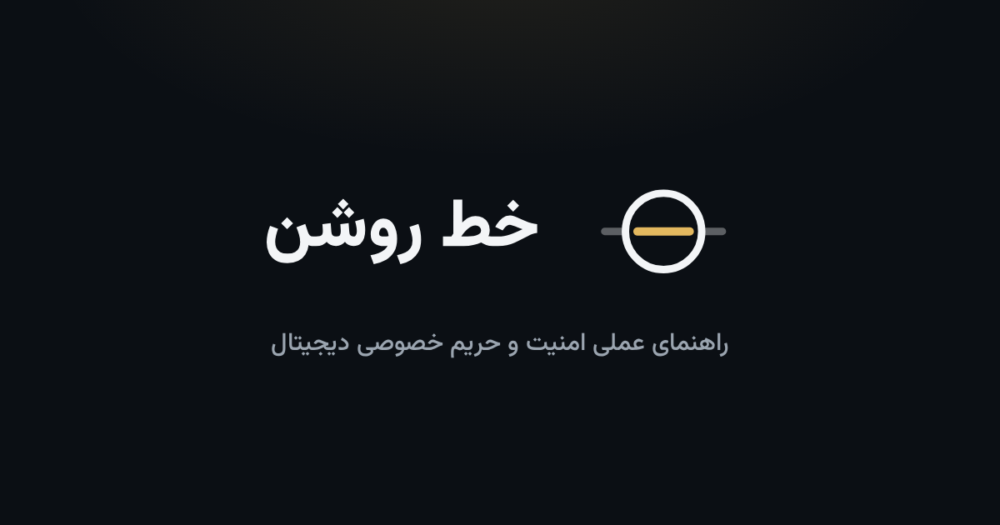
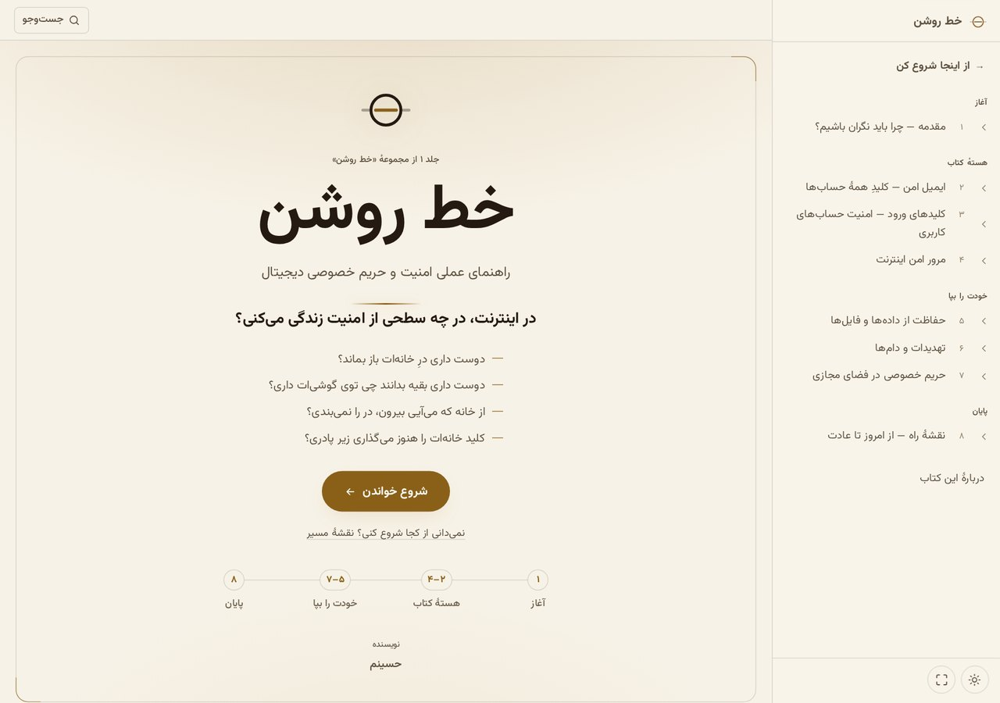
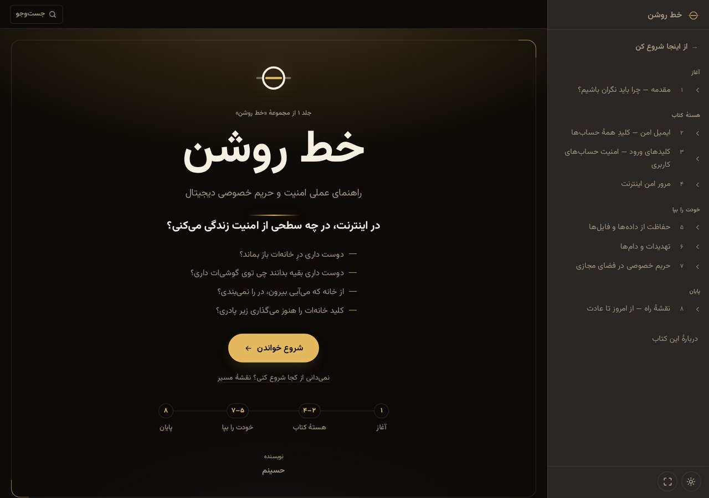

<div align="center">



<br />
<br />

[](https://nodahani.github.io/brightline-book/)
[](https://nodahani.github.io/brightline-book/)
[](https://github.com/nodahani/brightline-book)

[](LICENSE)
[](LICENSE-CONTENT)

</div>

<div dir="rtl">

# خط روشن

**راهنمای عملی امنیت و حریم خصوصی دیجیتال** — کتابی وب‌محور، فارسی و راست‌به‌چپ که مثل یک کتاب‌خوان واقعی طراحی شده است: بدون بک‌اند، بدون ابزار build، بدون هزینهٔ ماهانه. فقط HTML، CSS و JavaScript خالص روی GitHub Pages.

> اگر انسان واقعاً نداند و از روی ناآگاهی کاری را انجام دهد، گناه‌کار نیست؛ اما اگر بداند و آگاهانه انجام دهد، مسئول و مقصر است.
>
> — هدف این کتاب همین است: **از ناآگاهی بیرون آمدن.**

---

## ✨ چرا این کتاب‌خوان؟

- 📖 **تجربهٔ کتاب‌خوان واقعی** — جلد، فهرست کناری، ورق‌زدن، نوار پیشرفت و زمان تقریبی مطالعه
- 🎨 **۸ پوسته** — ۴ پالت (سپیا، مهتاب، کاغذ، زغال) × ۲ حالت روشن/تاریک
- 🔍 **جست‌وجوی آنی** در کل کتاب با هایلایت واژه (`Ctrl+K`)
- 🧘 **حالت تمرکز** — حذف همهٔ حاشیه‌ها برای خواندن عمیق (`Z`)
- 🗺️ **نقشهٔ راه تعاملی** — چک‌لیست «از امروز تا عادت» که پیشرفتت را در مرورگر ذخیره می‌کند
- 📱 **ورق‌زدن لمسی** روی موبایل + چیدمان کاملاً واکنش‌گرا
- 🔒 **حریم خصوصی در خودِ سایت** — فونت لوکال، بدون CDN، بدون ردیاب، بدون درخواست خارجی
- ♿ **دسترس‌پذیر** — پیوند پرش، نقش‌های ARIA، مدیریت فوکوس و پیمایش کامل با کیبورد
- 🔗 **لینک عمیق پایدار** — مسیریابی hash یعنی هیچ لینکی در GitHub Pages به ۴۰۴ نمی‌خورد

## 📸 پیش‌نمایش

| روشن (سپیا) | تاریک |
|:---:|:---:|
|  |  |

## 🚀 شروع سریع

فقط یک سرور استاتیک لازم است — هیچ نصب وابستگی‌ای وجود ندارد:

</div>

```bash
git clone https://github.com/nodahani/brightline-book.git
cd brightline-book
python3 -m http.server 8000
# حالا باز کن: http://localhost:8000
```

<div dir="rtl">

> ⚠️ فایل `index.html` را مستقیم از دیسک باز نکن؛ ماژول‌های JS و `fetch` به سرور نیاز دارند. هر سرور استاتیکی کار می‌کند: `npx serve`، `php -S`، یا افزونهٔ Live Server.

## 📚 فصل‌ها

| # | فصل | بخش |
|:---:|---|---|
| ۱ | [مقدمه — چرا باید نگران باشیم؟](https://nodahani.github.io/brightline-book/#/chapter/01-moghadame) | آغاز |
| ۲ | [ایمیل امن — کلیدِ همهٔ حساب‌ها](https://nodahani.github.io/brightline-book/#/chapter/02-imail) | هستهٔ کتاب |
| ۳ | [کلیدهای ورود — امنیت حساب‌های کاربری](https://nodahani.github.io/brightline-book/#/chapter/02-hesab) | هستهٔ کتاب |
| ۴ | [مرور امن اینترنت](https://nodahani.github.io/brightline-book/#/chapter/03-morur) | هستهٔ کتاب |
| ۵ | [حفاظت از داده‌ها و فایل‌ها](https://nodahani.github.io/brightline-book/#/chapter/04-dade) | خودت را بپا |
| ۶ | [تهدیدات و دام‌ها](https://nodahani.github.io/brightline-book/#/chapter/05-tahdid) | خودت را بپا |
| ۷ | [حریم خصوصی در فضای مجازی](https://nodahani.github.io/brightline-book/#/chapter/06-harim) | خودت را بپا |
| ۸ | [نقشهٔ راه — از امروز تا عادت](https://nodahani.github.io/brightline-book/#/chapter/07-jam) | پایان |

## ⌨️ میانبرها

| کلید | کار |
|:---:|---|
| `Ctrl+K` / `⌘K` | جست‌وجو در کتاب |
| `T` | روشن ↔ تاریک |
| `P` | پالت بعدی (سپیا → مهتاب → کاغذ → زغال) |
| `Z` | حالت تمرکز |
| `Esc` | بستن جست‌وجو / فهرست / خروج از تمرکز |
| کشیدن انگشت | فصل قبلی / بعدی (موبایل) |

## 🗂️ ساختار پروژه

</div>

```text
brightline-book/
├── index.html              # پوستهٔ اصلی + اسپرایت آیکون‌ها
├── 404.html                # صفحهٔ خطا با همان پوسته
├── assets/
│   ├── css/
│   │   ├── tokens.css      # همهٔ رنگ‌ها، فونت‌ها و پالت‌ها اینجاست
│   │   ├── base.css        # ریست و پایه
│   │   ├── book.css        # جلد، فصل، فهرست کناری
│   │   └── ui.css          # جست‌وجو، مودال، توست
│   ├── js/
│   │   ├── app.js          # راه‌اندازی و چرخهٔ حیات
│   │   ├── router.js       # مسیریابی hash
│   │   ├── content.js      # بارگذاری و اعتبارسنجی book.json
│   │   ├── views.js        # رندر جلد، فصل، نقشهٔ راه
│   │   ├── search.js       # جست‌وجو و هایلایت
│   │   └── ui.js           # کیبورد، لمس، پوسته‌ها
│   ├── fonts/              # وزیرمتن — لوکال، بدون CDN
│   └── brand/              # لوگو، فاوآیکون‌ها، تصویر اشتراک‌گذاری
├── content/
│   ├── book.json           # مانیفست: متا، بخش‌ها، فصل‌ها، جلد
│   └── chapters/           # هر فصل یک فایل HTML مستقل
└── docs/screenshots/       # پیش‌نمایش‌های همین README
```

<div dir="rtl">

## ✍️ ویرایش محتوا

هر فصل یک فایل HTML مستقل در `content/chapters/` است. برای تغییر متن، فقط همان فایل را ویرایش کن — نه پنل مدیریتی لازم است، نه بک‌اند.

برای افزودن فصل جدید:

1. یک فایل HTML در `content/chapters/` بساز (مثلاً `08-vpn.html`)
2. در `content/book.json` یک ورودیه به `chapters` اضافه کن:

</div>

```json
{
  "id": "08-vpn",
  "part": "guard",
  "label": "۹",
  "title": "وی‌پی‌ان — کی و چرا؟",
  "running": "وی‌پی‌ان",
  "file": "chapters/08-vpn.html"
}
```

<div dir="rtl">

اعتبارسنجِ داخلی، خطاهای رایج (id تکراری، بخش نامعتبر، فایل گم‌شده) را با پیام فارسیِ خوانا گزارش می‌کند.

رنگ‌ها و پوسته‌ها هم فقط در یک فایل تعریف شده‌اند: `assets/css/tokens.css`.

## 🎨 برند

نشان «خط روشن» — خطی طلایی که از میان حلقه می‌گذرد — مرزِ روشنِ امنیت و آگاهی است. حلقه رنگش را از متن می‌گیرد و خط طلایی از `--cover-accent`؛ پس نشان با هر ۸ پوستهٔ کتاب خودکار هماهنگ می‌شود.

| نقش | رنگ |
|---|:---:|
| مرکّب شب | `#0B0F14` |
| طلایی روشن | `#E3B85F` |
| طلایی عمیق (پس‌زمینهٔ روشن) | `#B8873B` |
| سپید مهتاب | `#F3F5F7` |

فایل‌های برند (SVG، فاوآیکون، آیکون اپ و تصویر اشتراک‌گذاری) در `assets/brand/` هستند.

## 🛠️ فناوری

بدون فریم‌ورک، بدون وابستگی، بدون مرحلهٔ build:

- **HTML + CSS + JavaScript خالص** (ES Modules)
- **مسیریابی hash** — سازگار با GitHub Pages و بدون ۴۰۴ در لینک‌های عمیق
- **فونت وزیرمتن لوکال** — کتاب حتی بدون اینترنتِ خارجی هم کامل بارگذاری می‌شود
- **ذخیره‌سازی محلی** — فقط پوستهٔ انتخابی و پیشرفت نقشهٔ راه در `localStorage`

استقرار: شاخهٔ `main` را در **Settings → Pages** به‌عنوان منبع GitHub Pages انتخاب کن؛ تمام. فایل `.nojekyll` هم از قبل آماده است.

## 📄 پروانه‌ها (دوگانه)

این مخزن دو پروانهٔ جدا دارد — یکی برای کد، یکی برای متن:

| بخش | پروانه | یعنی چه؟ |
|---|---|---|
| **کد کتاب‌خوان** — `assets/js`، `assets/css`، `index.html`، `404.html` | [MIT](LICENSE) | آزاد برای هر استفاده‌ای، حتی تجاری؛ فقط متن پروانه را نگه دار |
| **متن کتاب** — `content/` | [CC BY-NC-ND 4.0](LICENSE-CONTENT) | بازنشر با ذکر نام آزاد است؛ استفادهٔ تجاری و ساخت نسخهٔ تغییریافته ممنوع |
| **نام و نشان «خط روشن»** — `assets/brand/` | © تمام حقوق محفوظ | بخشی از هیچ‌کدام از دو پروانه نیست؛ برای کتاب خودت برند خودت را بساز |

خلاصه: می‌توانی از پوستهٔ کتاب‌خوان برای کتاب خودت استفاده کنی، ولی متن این کتاب را نمی‌توانی بفروشی یا تغییر بدهی و نشان «خط روشن» را هم نمی‌توانی جای برند خودت بگذاری.

متن کتاب © حسینم، ۱۴۰۵.

---

<div align="center">

**[📖 شروع خواندن](https://nodahani.github.io/brightline-book/)** · **[🗺️ نقشهٔ راه](https://nodahani.github.io/brightline-book/#/start)** · **[دربارهٔ کتاب](https://nodahani.github.io/brightline-book/#/about)**

</div>

</div>
